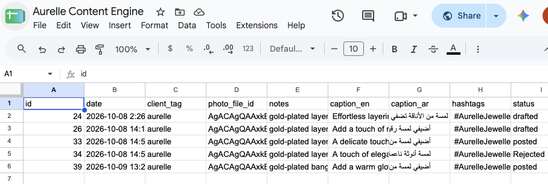

# Content Bot

An n8n workflow that turns a product photo into a ready-to-post social media caption in English and Arabic, and only publishes it after I approve it.

I built it around a made-up brand, Aurelle Jewellery (gold-plated jewellery), to practise building AI content automation end to end.

Demo video: _add link here_

## How it works

1. I send a photo to a Telegram bot with a short note, for example:
   `#aurelle gold-plated layered necklace, gift idea, 120 AED`
2. The workflow checks that a caption was included, then reads the brand tag and product notes.
3. It looks up the brand's tone and audience in a Google Sheet.
4. Gemini writes an English caption, an Arabic caption and hashtags, returned as JSON.
5. A Code node parses the JSON, and the draft is saved to the sheet with status `drafted`.
6. The bot sends me the draft with Approve / Disapprove buttons.
7. Approve: it posts to the brand's Telegram channel and marks the row `posted`.
   Disapprove: it marks the row `rejected`.

A second workflow sends me a Telegram alert if anything fails, including when a photo is sent without a caption.

## Screenshots

| Draft for approval | Published post |
|---|---|
|  |  |

Content log in Google Sheets:

Error alert workflow:

## Tools

- n8n (Cloud)
- Google Gemini (Flash model)
- Google Sheets
- Telegram Bot API
- JavaScript in an n8n Code node

## Files

- `workflow/content-engine.json` – main workflow
- `workflow/error-alerts.json` – error alert workflow
- `Sheet Template/columns.md` – Google Sheet layout

## Running it yourself

1. Create a Telegram bot (@BotFather) and a public channel, and add the bot to the channel as an admin.
2. Set up the Google Sheet as described in `Sheet Template/columns.md`.
3. In n8n, add credentials for Telegram, Google Gemini and Google Sheets.
4. Import both JSON files and replace the placeholders:
   - `YOUR_GOOGLE_SHEET_ID` in the Google Sheets nodes
   - `@your_channel` in Post to Channel
   - `YOUR_TELEGRAM_CHAT_ID` in the error workflow
5. In the main workflow's settings, set Error Workflow to the alerts workflow.
6. Publish both workflows and send the bot a photo with a caption.

## Notes

- Publishing goes to a Telegram channel because it's free and needs no business account. The same final step could post to Instagram instead.
- The Clients tab can hold more than one brand. Each brand gets its own tag, so the same workflow works for all of them.
- The prompt tells the model not to make false claims (gold-plated, not solid gold) and to keep emojis to a minimum.
